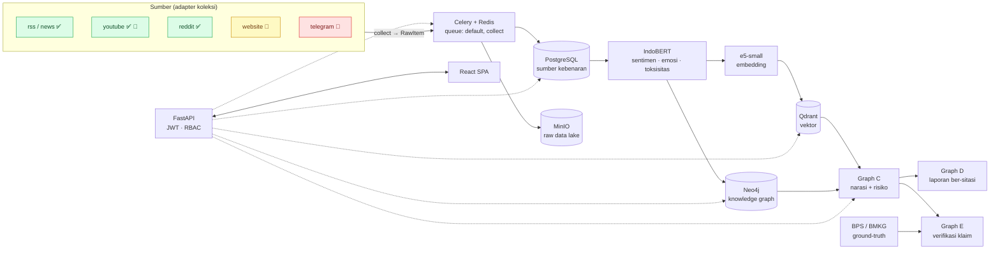
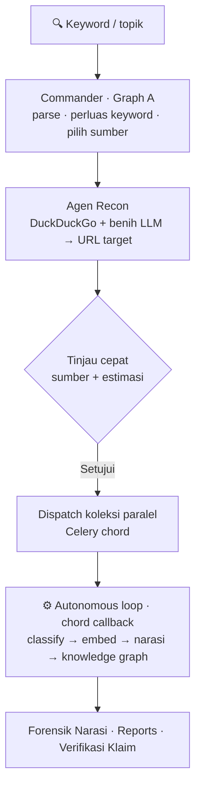
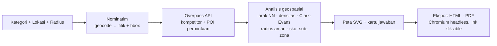

# Zandar OSINT Intel


Platform **OSINT analisis sentimen & forensik narasi** berbahasa Indonesia — dari
satu kata kunci, agen memilih sumber, mengumpulkan wacana publik, mengklasifikasi,
mengelompokkan jadi narasi, memetakan entitas, dan memverifikasi klaim terhadap
sumber resmi. Ditambah pilar **Riset Pasar Geospasial** untuk analisis lokasi bisnis.

> Prinsip arsitektur (PRD §6): **LangGraph berpikir, Celery bekerja, model lokal
> mengklasifikasi, database mengingat.** LLM dipakai untuk *penalaran agregat*
> (memilih sumber, melabeli narasi, menulis laporan) — **bukan** per-item.

### Sekilas: apa yang benar-benar jalan vs butuh konfigurasi

Dokumen ini **tidak melebih-lebihkan**. Penanda status dipakai konsisten:
✅ jalan tanpa setup · 🔑 butuh kredensial · 🔗 butuh URL/target · 🧪 stub/menyusul.

---

## Yang dilakukan platform (pilar)

| Pilar | Ringkas | Status |
|---|---|---|
| **Forensik narasi & sentimen** | koleksi → klasifikasi IndoBERT → klaster narasi (Graph C) → kuadran otentisitas×kebenaran, deteksi CIB | ✅ |
| **Skor reputasi agregat** | rating bintang review (Play/App Store) + sentimen teks → indeks reputasi 0-100 + distribusi + per-platform | ✅ |
| **Early Warning (deteksi krisis)** | lonjakan komentar negatif per jam vs baseline → level calm/elevated/spike + alert **Telegram/email gratis** ke tim PR (dedup) | ✅ |
| **ABSA (sentimen per-aspek)** | pecah sentimen per aspek bisnis (Harga/Produk/Pelayanan/Pengiriman/Aplikasi) via leksikon lokal — bukan cuma positif/negatif global | ✅ |
| **Share of Voice + NSS** | pangsa suara merek vs kompetitor (volume) + Net Sentiment Score per merek — dari entitas organisasi di knowledge graph | ✅ |
| **Buzzer / amplifikasi** | deteksi akun buzzer via perilaku (repetisi konten, koordinasi lintas-akun, burst timing) + klaster kampanye — pseudonim, tanpa data follower | ✅ |
| **Keyword discovery (grounded)** | tambang keyword baru dari data NYATA (hashtag/entitas/frasa dominan) untuk perluas scan — bukan sinonim karangan LLM | ✅ |
| **Scan Commander (autonomous loop)** | 1 keyword → agen pilih sumber → koleksi → analisis penuh **otomatis** | ✅ |
| **Verifikasi klaim** | klaim narasi diadu ke ground-truth resmi **BPS/BMKG** (Graph E, gaya AVeriTeC) | ✅ |
| **Riset Pasar Geospasial** | kategori + lokasi → peta kompetitor, jarak aman, radius, sub-zona efektif (OpenStreetMap) | ✅ |

---

## Arsitektur



---

## Agen (LangGraph): Commander → Narrator → Reporter → Verifier

Pipeline analisis = empat graph LangGraph. Framing "agent": *Commander* merencanakan,
sisanya mengeksekusi. LLM hanya di simpul penalaran (Tier R reasoning / F flash);
klaster & skoring = kode deterministik.

| Graph | Peran | LLM? | Keluaran |
|---|---|---|---|
| **A · Commander/Planner** | parse intent → perluas keyword → pilih sumber → estimasi biaya → approval | R+F | rencana koleksi |
| **C · Narrator** | klaster vektor (leader-clustering) → labeli narasi → skor risiko (ABCD) | F | narasi + kuadran |
| **D · Reporter** | narasi + bukti → laporan ber-sitasi (bahasa awam, band kualitatif) | R | laporan MinIO |
| **E · Verifier** | ekstrak klaim → adu ke bukti internal + BPS/BMKG → verdict (AVeriTeC) | F | verdict + veracity |

---

## Scan Commander — autonomous loop

Ganti alur manual "buat koleksi satu per satu" dengan **satu tombol**: ketik topik,
agen urus sisanya sampai investigasi terisi penuh dan teranalisis.



- **Chord**: koleksi didispatch sebagai grup; begitu **semua** selesai, callback
  menjalankan rantai analisis penuh. `collect_source` tak pernah melempar (semua
  error ditangkap → dict), jadi callback dijamin jalan walau sebagian sumber gagal.
- **Agen Recon** (`graphs/recon.py`): menemukan URL target otomatis (DuckDuckGo HTML
  gratis + situs benih dari LLM) → mengisi adapter `website`, sehingga sumber
  berbasis-URL ikut terkumpul **tanpa** analis mengetik URL. Tidak men-scrape Google
  langsung (diblokir + langgar ToS). Ditambah **tulang punggung deterministik**
  (`graphs/media_seeds.py`): media besar Indonesia terverifikasi — **umum + bisnis +
  investasi** (Kompas/Detik/CNBC/Katadata/Kontan/Bareksa) — otomatis dipasang via
  adapter `sitemap`, jadi riset bisnis/brand tak bergantung keberuntungan pencarian.

Terbukti end-to-end pada topik nyata "bisnis laundry": 5 sumber → ~1.040 item
(youtube 922 via pencarian keyword, news 100, website 18 via Recon) → 13+ narasi.

---

## Riset Pasar Geospasial

Pilar general-purpose (bukan hanya laundry): **kategori bisnis + lokasi** → analisis
kelayakan lokasi dari **OpenStreetMap** (gratis, tanpa API key).



Menjawab 3 pertanyaan lokasi: **jarak aman antar-kompetitor**, **radius aman**
(estimasi berbasis densitas), **sub-zona paling efektif** (permintaan ÷ kompetitor).
8 kategori siap pakai (`laundry, cafe, resto, minimarket, apotek, salon, bengkel, gym`)
di `geo/catalog.py` — tambah kategori = tambah entri, engine tak berubah.

> **Catatan jujur:** cakupan OSM di Indonesia = **batas bawah** (usaha kecil/informal
> sering belum terpetakan). Angka kompetitor adalah minimum, bukan sensus — hasil
> selalu menyertakan caveat ini. Untuk presisi, langkah berikut = Google Places (berbayar).

---

## Adapter koleksi (23 metode, 3 tier)

Semua adapter berbagi kontrak `collect(query) → RawItem[]` dan mendeklarasikan metadata
akses (dibaca UI, planner, estimasi biaya) — cek `GET /api/v1/sources/adapters`.

| Adapter | Tier | Kapabilitas | Catatan |
|---|---|---|---|
| `rss` | free | ✅ keyword | `feeds` kosong → **Google News RSS** dari keyword otomatis |
| `news` | free | ✅ keyword | GDELT DOC 2.0; fallback Google News bila GDELT keblok |
| `reddit` | free | ✅ keyword | `search.json` publik; tanpa subreddit → pencarian global |
| `youtube` | free | ✅ keyword 🔑 | Data API; tanpa `video_ids` → **search.list** dari keyword → komentar |
| `playstore` | free | ✅ keyword | **review aplikasi** (bintang + teks) — sinyal reputasi terstruktur; brand → app → review |
| `appstore` | free | ✅ keyword | **review iOS** (Apple RSS publik) — melengkapi playstore untuk reputasi app |
| `website` | free | 🔗 URL | web_extract (hormat robots.txt); **diisi otomatis oleh agen Recon** |
| `sitemap` | free | 🔗 URL | **koleksi bulk arsip situs** via sitemap.xml (index bertingkat + .gz) → ekstraksi trafilatura; portal berita ID skala arsip penuh, filter tanggal/keyword. Jalur patuh (sitemap = undangan crawler), tanpa proxy/evasion |
| `blog` | free | 🔗 URL | autodiscovery feed → teks penuh |
| `forum` | free | 🔗 URL | Discourse JSON; tanpa `base_url` → fail-soft (0, bukan error) |
| `wayback` | free | 🔗 URL | arsip Archive.org — **bulk CDX** (paginasi resumeKey + sampling temporal lintas tahun); mode `extract` (teks artikel) / `index` (bukti keberadaan URL, murah, volume besar); konten dihapus & evolusi narasi |
| `youtube_transcript` | free | 🔑 | closed caption publik (tanpa kuota Data API) |
| `har` | free | ✅ | parse `.har` ekspor manual analis (human-in-the-loop) |
| `github` | free | 🔑 | REST resmi (butuh token) |
| `telegram` | free | ✅ keyword 🔑 | **channel publik via MTProto** — keyword → **auto-discover channel** (contacts.Search), tak perlu ketik username. Gratis, skala besar (berita/komunitas/buzzer). Butuh `api_id/api_hash` + StringSession (`scripts/telegram_session.py`, sekali) |
| `nitter` | free | 🔗 | front-end X publik — mayoritas instance mati sejak 2024 |
| `x` | metered | 🔑 | API v2 pay-per-use (~$0,005/post) — **cost guard wajib** |
| `x_vendor`, `tiktok` | vendor | 🔑 | shadow API / penyedia data berkontrak |
| `apify` | vendor | 🔑 | **actor Apify** (bayar-per-run) → sumber anti-bot **legal**: Google Maps reviews, Shopee, Instagram, dll. Satu adapter, banyak actor via config; rating review → skor reputasi. `field_map` eksplisit, cap biaya wajib |
| `bps`, `bmkg` | free | ✅ | **ground-truth resmi** (statistik, gempa) — untuk verifikasi, bukan wacana |
| `ckan` (satudata) | free | 🔗 | portal data terbuka daerah (butuh `base_url`) |

**Prinsip kepatuhan:** TIDAK ada akun tumbal, rotasi token/IP, atau bypass
bot-detection — itu mencemari kepatuhan (UU PDP) dan membuat lalu lintas kita
menyerupai CIB yang justru kita deteksi. Jalur murah = arsip publik + vendor +
import manual + pencarian resmi, **bukan** scraping gerilya.

---

## Klasifikasi lokal (IndoBERT) — tervalidasi gold set

Baseline `lexicon` (default) jalan tanpa dependensi. Jalur produksi = **IndoBERT
hibrida** (RoBERTa fine-tuned Indonesia untuk sentimen + leksikon untuk intent):

```bash
pip install -e ".[ml]"          # torch + transformers (~2.5GB)
# .env:
CLASSIFIER_PROVIDER=indobert
```

Divalidasi terhadap gold set berlabel manusia (tanpa pelabelan manual kita):

| Tugas | Model | Gold set | F1 |
|---|---|---|---|
| Sentimen | IndoBERT | NusaX-Senti | **0.894** ✅ (gate ≥0.82) |
| Toksisitas | dehatebert | Ibrohim & Budi 2019 | **0.865** ✅ |
| Emosi | StevenLimcorn/emotion | IndoNLU EmoT | **0.717** (SOTA 5-kelas) |
| — | lexicon (baseline) | NusaX-Senti | 0.541 (sengaja baseline) |

Teks panjang (artikel penuh) dipotong ke ~1.500 char sebelum RoBERTa (batas 512 token).
CPU ~22 komentar/dtk (100rb ≈ 75 mnt); GPU CUDA 5–10× lebih cepat. Cache Redis
menghindari klasifikasi ulang teks identik. `refine` sarkasme (LLM per-item, low-conf
saja) — **catatan skala:** untuk ratusan ribu+ item, jadikan sampling.

---

## LLM: Bedrock multi-model + fallback

Provider LLM abstrak (Tier R reasoning / F flash). Konfigurasi via `LLM_PROVIDER`.
`bedrock` memakai **satu bearer token** Amazon Bedrock (Converse API) dengan **rantai
fallback** — model non-Anthropic diutamakan (murah), Claude opsi terakhir:

```
BEDROCK_MODEL_R=qwen3-235b → amazon.nova-pro → anthropic.claude-sonnet   (reasoning)
BEDROCK_MODEL_F=deepseek-v3 → amazon.nova-micro → anthropic.claude-haiku (flash)
```

Provider lain didukung: `stub` (default, tanpa biaya), OpenAI-compat
(OpenRouter/Groq/Gemini/Cerebras). `data_policy=local_only` pada investigasi memaksa
klasifikasi model lokal — konten tak dikirim ke API pihak ketiga.

---

## Struktur

```
core/      # config, db (async SQLAlchemy 2.0), security JWT/RBAC, model
api/       # FastAPI — auth, investigations, collections, analysis, market, planner ...
workers/   # Celery — adapter koleksi, enrichment, klasifikasi, autonomous loop
  adapters/#   18 metode koleksi (kontrak collect→RawItem)
  classify/#   IndoBERT + leksikon + preprocess + refine + cache
graphs/    # LangGraph A/C/D/E + recon (agen target discovery) + runner + llm
geo/       # Riset Pasar Geospasial (OSM/Overpass, analisis, laporan HTML/PDF)
web/       # frontend React (Vite) — Scan, Riset Pasar, Forensik, Reports ...
alembic/   # migrasi database    ·    scripts/ utilitas    ·    tests/ smoke
```

---

## Quickstart

Prasyarat: Python 3.11+, Docker Desktop.

```bash
# 1. Konfigurasi
cp .env.example .env        # ganti JWT_SECRET; isi LLM_PROVIDER bila pakai Bedrock

# 2. Infrastruktur (PostgreSQL, Redis, Qdrant, Neo4j, MinIO)
docker compose up -d

# 3. Dependensi
python -m venv .venv
.venv\Scripts\activate      # Windows  (Linux/Mac: source .venv/bin/activate)
pip install -e ".[dev]"

# 4. Migrasi + user admin
alembic upgrade head
python scripts/create_admin.py --email admin@zandar.local --password gantipassword

# 5. API + worker + frontend
uvicorn api.main:app --reload
celery -A workers.celery_app worker --loglevel=info --pool=threads -Q default,collect
cd web && npm install && npm run dev
```

Frontend dev: Vite (proxy ke API) · Swagger UI: `/docs` · Neo4j `:7475` ·
MinIO Console `:9003` · Qdrant `:6335/dashboard`.

Ekspor PDF (Riset Pasar & agen Recon) memakai **Chromium headless** — Chrome/Edge di
host (di Windows, Edge selalu ada). Deploy Linux: lihat [`docs/pdf-export.md`](docs/pdf-export.md).

---

## Catatan Windows (penting)

Divalidasi di Windows 11 + Docker Desktop:

- **Port digeser ke rentang terisolasi** (`5433/6380/6335-6336/7475/7688/9002-9003`)
  agar tidak bentrok stack lain. Lihat `docker-compose.yml`.
- **Pakai `127.0.0.1`, bukan `localhost`** di `.env` (localhost bisa resolve ke
  IPv6/WSL → MinIO hang ~21 dtk/permintaan).
- **Celery worker WAJIB `--pool=threads`** (solo/prefork menggantung di Windows).

---

## Batasan & skala (jujur)

- **Sumber gratis punya plafon.** Google News ~100/feed, YouTube kuota 10rb unit/hari,
  Reddit ID tipis. Untuk **jutaan** item lintas medsos → butuh firehose berbayar
  (X Enterprise, social-listening). "Jutaan" biasanya dicapai lewat **akumulasi
  koleksi terjadwal** seiring waktu, bukan sekali sedot.
- **Telegram & Common Crawl** = lever volume besar tapi **belum dibangun** (Telegram
  stub; Common Crawl butuh adapter + infra big-data).
- **Klaster narasi** memuat vektor ke memori (leader-clustering, bukan O(n²)) + LLM
  label dibatasi 25 cluster teratas — memadai puluhan ribu; untuk 100rb+ perlu
  klaster minibatch + refine sampling + inference GPU/ONNX.
- **GDELT** bisa terblokir di sebagian jaringan lokal → adapter `news` fallback ke
  Google News RSS otomatis.

---

## Kepatuhan

Identitas penulis komentar disimpan sebagai `author_hash` (pseudonim) sejak ingestion.
`data_policy=local_only` memaksa klasifikasi model lokal — konten tak dikirim ke pihak
ketiga. Raw payload immutable di MinIO (replay bila model membaik). Detail: PRD §12–13.
```
